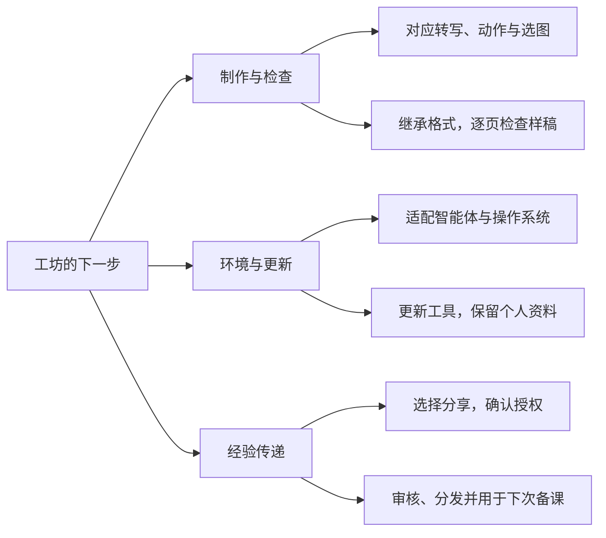

# 开发参与与改进路线

## 🛠️ 怎样参与3.x.x更新

如果你愿意一起开发或维护手语歌智能工坊，欢迎申请加入 **Sign Song Studio**。请通过 **QQ 私聊联星老师**，或[发邮件](mailto:liqiding@mail.ustc.edu.cn)，附上 GitHub 用户名，简单说说你想参与哪方面。代码、使用说明、测试和发布维护都欢迎有人接力。收到邀请后，在组织仓库里讨论任务、提交修改和一起审核。

遇到问题或有改进建议，可以直接在**公开仓库的 Issues** 留言，无需加入组织。说清遇到了什么、希望怎样改就可以。涉及校内讲义或其他未公开资料，请私下联系。

### 从里程碑找任务

在 [Milestones（里程碑）](https://github.com/LuckytoeUSTC/sign-song-agent-public/milestones)查看正在推进的目标，点进一个方向，就能看到归入其中的Issue和完成进度。目前整理了七个方向：

| 方向 | 关心的问题 |
|---|---|
| 经验传递机制的建设 | 个人经验怎样审核、分享，并用于下一次备课 |
| 架构与兼容 | 适配模型与系统，提高执行效率和准确性 |
| 许愿机->学习机 | 怎样在互动备课中帮老师学习手语 |
| 授权和推广 | 选择上传内容、确认授权与扩大使用范围 |
| 志愿者招募和项目移交 | 谁来参与建设、接手维护 |
| 如何实现项目更新 | 更新工具和公共资料，保留用户自己的修改 |
| 提高制作质量 | 改善翻译、讲义规范和制作检查 |

里程碑汇集一个目标下的任务；每个具体问题用Issue记录。整理Issue时可沿用现有标签：`bug`记录故障，`enhancement`提出功能或改进，`documentation`修改说明，`question`讨论疑问，`accessibility`关注无障碍使用。`good first issue`标出适合新参与者的任务，`help wanted`表示需要协作；它们可以和任务类型一起使用。

参与前先查有没有相同问题；想认领时，在对应Issue下说明准备做什么。提交新Issue时写清问题或目标、有关版本和例子，维护者再关联合适的里程碑与标签。一个大目标可以拆成多个能单独讨论、验证的小任务。

### 发布与更新

v3.2.0改为一个跨系统完整工作空间包，不提供旧项目覆盖包。v3.1.1的三系统完整包及仅适用于Windows版v3.1.0的覆盖包继续保留。源码与发布包可能分别更新，源码ZIP也不等于正式附件。

目前已有文件归属说明与发行清单，但还没有自动更新或合并。旧项目怎样安全升级、公共资料更新时怎样保留个人修改，仍需解决。新制作数据使用的格式已经改变，不能直接覆盖或批量迁移旧实例。后续发布应写清适用版本、替换范围、备份及恢复办法。

## 🗺️ 后续改进路线

以下是基于几次备课测试提出的改进方向。理想目标见[README](README.md)，具体实现留待参与者讨论和验证。

## 🌱 重点议题：怎样把细节经验与语感传下去

**这是联星老师最希望有人接力完成的功能。** 希望把老师掌握的细节经验写清楚，让换了老师、换了项目的智能体也能用上，减少对模型记忆上下文、自己提炼经验的依赖。

已有规则、例句、修改案例和检索工具，但从个人经验的输入，到审核、分享，再到下一次正确使用，还缺少顺畅的全过程。下面集中列出需要共同考虑的问题，以及已经比较明确的基础办法。

### 四个案例，说明经验为什么难传

- **词序调整的适用范围。** 怎样让智能体先检查词语在句中的作用，再决定是否调整顺序？
- **“上、下”可以用空间表达。** 对象的位置和运动有时已经表达上下关系。怎样记录具体的空间组织，让模型能比较是否还需要独立的方位词？
- **“在”可以因歌曲而省略。** 老师平时习惯打出“在”，快速、活泼、诗意的歌曲里却可能省略。怎样同时留下日常习惯和本曲取舍，让模型知道何时参考哪一种？
- **类标记有各自的使用习惯。** 用什么手形代表马或马车、哪只手表示谁、如何运动和配合，都会影响理解。怎样保存这些细节及示范，让其他老师和智能体读得懂？不同老师、社群的习惯怎样并存？

这些案例来自老师的实际反馈，整理时需核对原例的动作、场景和修改理由。可以先用它们检验经验传递，再逐步扩展。

### 从输入到调用，需要回答哪些问题

| 环节 | 需要共同考虑的问题 |
|---|---|
| 输入形式 | 老师口述、文字批注、对话修改、手势图解和示范视频怎样整理？哪些信息必须有，哪些可后补？ |
| 输入时机 | 修改一句、审核样句、讨论全曲、试打和课后反馈时，怎样顺手记录，又尽量少打断备课？ |
| 发现经验 | 怎样察觉可复用的经验？怎样区分旧经验的补充、新建议和本曲选择？遇到冲突怎么办？ |
| 批量录入 | 老成员能否一次输入多年积累的词序、空间、类标记和节奏经验？怎样保留原话、查重、补齐原例？ |
| 审核 | 哪些内容需要谁确认？怎样分主题批量审核？意见不同、缺示范或尚未试打时，怎样继续处理？ |
| 分类 | 词义词序、空间指代、类标记描写、节奏省略、教学取舍和版式操作怎样分类？个人习惯、社群经验、本曲选择和公共参考怎样区分？ |
| 保存 | 怎样关联原句、前后方案、理由、原件和不同用法？怎样修订、撤回和保留历史？ |
| 分发 | 谁收集、审核和维护？怎样只上传获准部分，把修订送到其他老师手里，同时保留他们的修改？ |
| 调用 | 开始备课、转写、查词、选图和复核时各需要什么经验？怎样结合关键词、语义和场景，减少漏用与套错？ |
| 效果 | 怎样知道另一位老师确实用上了？是否减少重复解释和纠错，并帮助老师学习表达？ |

### 已有基础与比较明确的办法

**记录要带原例和理由。** 保留原句、修改前后方案、老师理由、来源及适用条件，区分老师原话和AI归纳。类标记还需说明字母记法对应的手形、指代对象、位置、运动和双手关系，必要时关联获准使用的动作示范。

**审核需要可指定的条目。** 沿用稳定编号，让老师能直接说通过、修改或暂缓哪些条。现有每批3—5条的集中审核可以继续使用，批量大小按老师需要调整。对一句表达的认可，还需确认能否推广到其他歌曲或社群。

**完整原件与案例检索配合。** 参照讲义帮助理解整体表达，检索帮助找具体问题的旧例。新稿保留简短依据，方便老师查到为什么这样选、参考了什么、与旧例有什么差别。

**调用要分开检验。** 经验有没有送到模型面前、模型是否判断适用、最后是否落实到转写和手势图解，是三个不同问题。已有案例可组成适用例与易误用例的对照测试；程序核对确定的要求，老师试打表达与动作。

**分享由提供者选择。** 一条经验、一个片段或一份讲义都可以，先确认待分享内容、署名和使用范围。授权审核与手语内容审核分别完成，具体分工见下文。

具体采用什么存储格式、怎样组织检索和同步、是否调整现有数据库与目录，留给参与者结合成本讨论。目标是让另一位老师的下一次备课用上经验，修订也能持续传过去。

## 📖 让备课成为学习手语的过程

希望工坊不仅能协助完成讲义，也能在备课过程中帮助老师理解手语、积累表达经验。从选歌、讨论转写，到比较不同打法、试打和修改，每一步都有可能成为学习的机会。

这一部分目前还没有展开探索。期待有兴趣的开发者和手语老师一起想象：智能体还能以怎样的方式陪伴老师学习，让每次备课的收获留在老师身上，也带到下一次教学中。

## 💻 环境与架构

希望不同智能体和电脑都能完成备课。现在文件读写、看图、运行脚本、网络检索、Word 操作权限和文档预览的支持各不相同；哪些依赖程序、哪些依赖模型、哪些需要老师判断，怎样划分才可靠？工具和资料怎样更新，才能保留个人修改、失败后也能恢复？

**AI提供的参考意见：** 沿用制作内容、版式配置与排版代码分离的基础，集中维护通用工具；先实测常用客户端与系统，再讨论适配和更新机制。

## 📚 资料授权与共享

部分讲义来自本社群共享资料，尚未全部向制作者确认扩大使用范围的授权。对外推广前，需要逐项确认允许谁使用、是否允许修改和再分发，代码许可与材料授权分别处理。个人经验由提供者选择分享内容和范围。

谁来接收材料、核对授权、审核手语内容和发布？怎样让提供者确认上传内容，怎样处理纠错与撤回？这些工作需要有人持续负责，已下载副本也存在难以追回的问题。

**AI提供的参考意见：** 先让提供者预览选定内容，再分别完成授权与表达审核；公开与限社群使用的材料分开管理，记录来源、授权范围和审核结果。具体渠道与分工共同商量。

## 🤝 不同社群怎样兼容

哪些是大家都需要的规范，哪些只是本手语组或某位老师的习惯？虚线框、斜体、类标记、借图提示和教学习惯可能各不相同。同一表达在不同歌曲中也会有不同取舍，需要怎样协调、保存和调用？

**AI提供的参考意见：** 保留图片完整、来源可查、个人文件受保护这些共同要求；社群习惯作为可选配置，本次制作采用老师确认的要求。表达经验保留场景、出处和不同用法，请有关社群的老师一起核对。

## 🙌 长期维护与交接

愿意长期参与，可以联系联星老师说明想承担的部分。先合作完成一次更新，再商量维护权限、审核和发布分工。联星老师目前精力有限，回复与审核可能需要等待；技术维护志愿者尤其需要有人接力。

未来向科大[“词元计划”成长营](https://git.ustc.edu.cn/ustcnic/ai)投稿，可以提交获准公开的使用实例和项目链接，源码、问题跟踪与发布继续集中维护。
